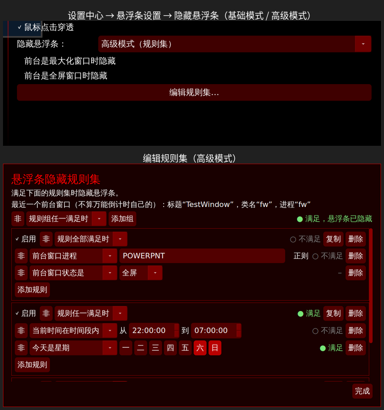

# 悬浮条隐藏规则（基础模式 / 高级模式）

参考 ClassIsland 2 的“隐藏窗口”设置，给顶部悬浮条加上按条件自动隐藏的功能，在“设置中心 → 悬浮条设置 → 隐藏悬浮条”里：

- **基础模式**（默认）：勾选的条件**任一满足**就隐藏
  - 前台是最大化窗口时隐藏（默认不勾）
  - 前台是全屏窗口时隐藏（默认不勾）

  ClassIsland 基础模式里还有一条“上课时”，万能倒计时没有课表，按你的要求去掉了。
- **高级模式（规则集）**：点“编辑规则集…”打开编辑窗口，规则集满足时隐藏。结构、判断方式和 ClassIsland 一样：
  - **规则集**由若干**规则组**组成：规则组任一满足 / 全部满足，可以“非”（反转）
  - **规则组**里有若干**规则**：规则任一满足 / 全部满足，可以“非”，可以停用、复制、删除
  - **规则**可以单独“非”。可选的规则：
    - 前台窗口标题 / 类名 / 进程：和 ClassIsland 一样，不勾“正则”时要完全相同，勾了“正则”时只要能匹配上。进程名在 Windows 上不带 `.exe`，例如 PowerPoint 是 `POWERPNT`
    - 前台窗口状态是：普通 / 最大化 / 最小化 / 全屏。和 ClassIsland 一样，全屏的窗口不算“最大化”
    - 当前时间在时间段内：包含开始时间，不包含结束时间；结束早于开始时表示跨过午夜（如 22:00 到 07:00）
    - 今天是星期：可多选
    - 距目标时间剩余天数：≤ / ≥ / =，天数和悬浮条上显示的一致
    - 总是为真 / 总是为假
  - 编辑窗口里每个规则、规则组和整个规则集旁边会实时显示“满足 / 不满足”。顶部还会显示**最近一个前台窗口**（不算万能倒计时自己的）的标题、类名和进程，方便照着填规则。

满足条件时悬浮条直接隐藏，不满足时直接显示，没有动画（和 ClassIsland 一样）。每 500ms 判断一次。

## 和 ClassIsland 不同的地方

- **万能倒计时自己的窗口不算前台窗口**：设置中心和全屏提醒都是全屏窗口，如果算进去，勾了“前台是全屏窗口时”后，一打开设置中心悬浮条就会消失。所以自己的窗口在前台时，当作**没有前台窗口**。
- **没有前台窗口时，4 种前台窗口规则一律不满足**。ClassIsland 只有“进程”规则这样处理。如果标题规则也照它的做法，文本为空的规则会和“没有窗口”的空标题相等，刚选好规则类型悬浮条就会被隐藏。

  注意：加了“非”的前台窗口规则，在没有前台窗口时（包括正在用设置中心时）会变成满足。
- **悬浮条不再抢焦点**（`WA_ShowWithoutActivating` + `Qt::WindowDoesNotAcceptFocus`）。原来悬浮条显示时会变成前台窗口，隐藏规则按规则重新显示悬浮条时，会把用户正在用的窗口焦点抢走。在测试中这还会造成每 500ms 隐藏、显示来回闪。原来程序启动时悬浮条也会抢一次焦点，现在不会了。

## 改了哪些文件

- 新文件
  - `src/core/HideRules.h / .cpp`：规则集的数据结构、判断逻辑（照 ClassIsland 的 `RulesetService`）、JSON 读写
  - `src/core/ForegroundWindow.h / .cpp`：获取前台窗口的标题、类名、进程名和状态
    - Windows 用 Win32 API；判断全屏和最大化的方法照 ClassIsland：窗口盖住整个屏幕算全屏，盖住工作区算最大化，桌面（WorkerW / Progman）不算
    - Linux 用 X11：`_NET_ACTIVE_WINDOW`、`_NET_WM_NAME`、`WM_CLASS`、`_NET_WM_PID` + `/proc/<pid>/comm`、`_NET_WM_STATE`
  - `src/ui/HideRulesEditor.h / .cpp`：规则集编辑窗口
- `src/CMakeLists.txt`：加入新文件。Linux 上用 pkg-config 找 libxcb；找不到时照常编译，只是 Linux 上前台窗口相关的规则不生效，CMake 会给出警告。
- `src/core/ConfigManager.h / .cpp`：`config.ini` 的 `[floating_bar]` 里新增 `floating_bar_hide_mode`、`hide_on_max_window`、`hide_on_fullscreen`；规则集单独保存在 `floating_bar_hide_rules.json`
- `src/ui/FloatingBar.h / .cpp`：定时判断规则；显示和隐藏统一由 `updateVisibility()` 处理（“是否显示悬浮条”打开、并且不满足隐藏规则时才显示）；不抢焦点
- `src/ui/SettingsContent.h / .cpp`：新增设置项；原来直接调 `show()` / `hide()` 的地方改成 `updateVisibility()`，避免把被规则隐藏的悬浮条又显示出来
- `src/core/UniversalTimer2.cpp`：同上

## 应用

需要先应用 [features/floating-bar](../floating-bar/README.md)（悬浮条淡化、点击穿透和 Win11 样式）。打过 `fixes/second-skip` 也可以用。

- 会用 git：先 `git apply ../floating-bar/floating-bar.patch`，再 `git apply floating-bar-hide-rules.patch`
- 不会用 git（Linux）：先用 `features/floating-bar/one-click`，再用这里的 `one-click/`，用法一样（`bash apply.sh`，撤销 `bash undo.sh`）。还没应用 floating-bar 时，它会提示先应用，一个文件都不改。

Linux 上要让前台窗口相关的规则生效，编译时需要 libxcb 的开发包（Debian / Ubuntu：`libxcb1-dev`，一般装 Qt 开发包时已经带上了）。

## 验证

在 Linux 上用 Qt 6.10.1、Xvfb + xfwm4 4.18（开合成）测试：

- **判断逻辑**：单独的测试程序 41 项检查全部通过。覆盖每种规则类型、正则（含无效正则）、反转、组内 / 组间 且 / 或、停用的组、空组不参与、跨午夜时间段、没有前台窗口、JSON 往返。
- **基础模式**：用 wmctrl 把一个测试窗口切成全屏 / 最大化：
  - 勾了对应条件时悬浮条隐藏，取消后重新显示；
  - 没勾时不受影响。
- **高级模式，真实窗口**：
  - 在编辑窗口里用模拟键盘建一条“前台窗口标题 = TestWindow”规则，在两个窗口之间来回切换，悬浮条按预期隐藏 / 显示；
  - “进程 = fw 且 状态 = 全屏”和“类名正则 `^f` + 非”也按预期工作，切换 5 次只有 4 次状态变化，没有闪烁。
- **编辑窗口**：
  - 从文件读入包含全部规则类型的规则集，每种规则的控件都正确显示；
  - 添加组、复制组、删除组、停用组、规则集“非”、添加 / 删除规则都实际点过，规则文件和悬浮条状态都正确。
- **和上一版的配合**：
  - 默认配置下和原版截图逐像素一致；
  - 鼠标移入淡化正常；
  - 点击穿透在启动时、运行中开关、切换置顶 / 置底、被规则隐藏后重新显示后都正确；
  - 关掉“是否显示悬浮条”后，规则不会把它显示出来。
- **Windows**：用 MinGW 交叉编译器和 Windows 版 Qt 6.10.1，把整个程序编译成 Windows 程序（`UniversalTimer2.exe`），没有错误和警告。
- **一键包**：以下情况都测过：
  - 在 floating-bar 版本（LF）、CRLF + BOM 的源码、打过 second-skip 的源码上应用，结果和补丁逐字节一致；
  - 再运行一次提示“已经改过”；
  - 没装 floating-bar 时提示先装；
  - 代码对不上、或者新文件已经存在但内容不同时，一个文件都不改；
  - 撤销后完全恢复原样，新建的文件也会删掉；
  - 从干净的 a86dbfc 依次用两个一键包，结果能编译运行。

## 已知限制

- **Windows 上没有实际运行过**，只验证了能编译。获取前台窗口用的是常见的 Win32 API（`GetForegroundWindow`、`GetWindowTextW`、`GetClassNameW`、`QueryFullProcessImageNameW`、`IsIconic`、`GetMonitorInfoW`）。
- 全屏 / 最大化只和主屏幕比较（悬浮条只显示在主屏幕上）。
- Linux 上只支持 X11（XFCE 等），Wayland 原生窗口取不到前台窗口信息。
- 规则文件 `floating_bar_hide_rules.json` 也可以直接编辑，格式见 `HideRules.cpp` 的 `toJson()`。
