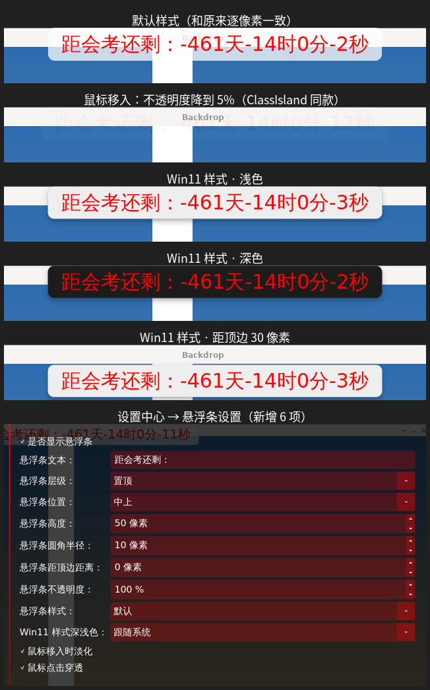

# 悬浮条：鼠标移入淡化、点击穿透、Win11 样式

参考 ClassIsland 2，给顶部悬浮条（`FloatingBar`）加了下面这些设置，都在“设置中心 → 悬浮条设置”里，改了立即生效：

| 设置项 | 默认 | 说明 |
| --- | --- | --- |
| 悬浮条圆角半径 | 10 像素 | 原有设置，两种样式共用 |
| 悬浮条距顶边距离 | 0 像素 | **新增**。默认和原来一样贴着屏幕顶边 |
| 悬浮条不透明度 | 100 % | **新增**。整个悬浮条（背景和文字）的不透明度，100% 就是原来的样子 |
| 悬浮条样式 | 默认 | **新增**。“默认”就是现在的样子；“Win11”是仿 Win11 的样式（见下） |
| Win11 样式深浅色 | 跟随系统 | **新增**。跟随系统 / 浅色 / 深色，系统切换深浅色时会实时跟着变 |
| 鼠标移入时淡化 | 开 | **新增**。鼠标移到悬浮条上时，不透明度在 100ms 内降到 5%，移开后恢复（数值和 ClassIsland 一样） |
| 鼠标点击穿透 | 开 | **新增**。点击直接落到悬浮条下面的窗口上，不会被挡住 |

## 参考 ClassIsland 的地方

ClassIsland 的源码（`ClassIsland/MainWindow.axaml.cs`、`Controls/MainWindowLine.*`、`XamlThemes/FluentTheme/Styles.axaml`）：

- **鼠标移入淡化**：整行的 `Opacity` 直接设成 `0.05`，用 100ms 渐变。没有开 RawInput 时，它靠定时查询全局鼠标位置来判断是否移入。这里也是每 50ms 查询一次 `QCursor::pos()`，因为开了点击穿透后窗口本身收不到鼠标事件。
- **触摸**：ClassIsland 的“触摸淡化持续时间”默认是 0，也就是和鼠标完全一样。这里也一样：手指点到悬浮条上时光标会移过去，悬浮条变淡，直到光标或手指移到别处。
- **点击穿透**：设置窗口的“输入透明”。Qt 里对应 `Qt::WindowTransparentForInput`，Windows 上是 `WS_EX_TRANSPARENT`，X11 上是空的输入区域。
- **Win11 样式**：对应它的 Fluent 主题，**只换背景**，文字颜色和字体都不动。
  - 底色 `SolidBackgroundFillColorSecondary`：浅色 `#EEEEEE`，深色 `#1C1C1C`
  - 1px 描边 `ControlElevationBorderBrush`：底边稍深，浅色 `rgba(0,0,0,0.16)` / 其余 `0.06`，深色 `rgba(255,255,255,0.09)` / `0.07`
  - 阴影 `BoxShadow="0 4 8 2 #48000000"`，用 `QGraphicsDropShadowEffect`（向下偏移 4、模糊 16、`#48000000`）近似
  - 圆角用原有的“悬浮条圆角半径”

  阴影画在悬浮条外面，所以 Win11 样式下窗口四周会留出一圈透明边距。悬浮条本身的位置不变，贴着屏幕边的那一侧不留边距。

## 改了哪些文件

- `src/core/ConfigManager.h / .cpp`：新增 6 个配置项（`config.ini` 的 `[floating_bar]` 组里：`floating_bar_top_margin`、`floating_bar_opacity`、`is_mouse_in_fading_enabled`、`is_mouse_click_through_enabled`、`floating_bar_style`、`floating_bar_theme`）。旧的 config.ini 没有这些项时按默认值处理。
- `src/ui/FloatingBar.h / .cpp`：样式、深浅色、阴影、不透明度、移入淡化、点击穿透、大小和位置都集中到这里（`updateStyle()`、`updateWindowFlags()`、`updateOpacity()`、`updatePosition()`）。构造函数多了一个 `ConfigManager&` 参数。
- `src/core/UniversalTimer2.cpp`：创建悬浮条时传入配置；`refresh()` 和每秒的 `updateFloatingBar()` 改为调用上面几个函数，不再自己拼样式表、设窗口标志和算位置。原来的 `setFixedHeight()` 换成直接设置 `Bar` 的高度，否则 Win11 样式没法给阴影留位置。
- `src/ui/SettingsContent.h / .cpp`：新增 6 个设置控件。“悬浮条层级”“悬浮条高度”“悬浮条圆角半径”也改为调用上面的函数，这样不会丢掉点击穿透和 Win11 样式。

### XFCE（xfwm4）上点击穿透的一个坑

xfwm4 会给每个窗口套一层外框窗口。它只在**已经接管窗口之后**收到“输入区域变化”的通知时，才会把外框也设成可穿透（4.18 源码里 `frameSetShapeInput()` 只在 `handleShape()` 里调用）。而 Qt 修改窗口标志时，会先把窗口隐藏、改好、再显示，xfwm4 正好错过这次通知。结果是悬浮条自己已经穿透了，外框还挡着点击，在设置里运行中打开点击穿透就会无效。

所以 `FloatingBar` 在每次显示后第一次画到屏幕上时（这时窗口一定已经被接管），在 X11 上把点击穿透关一下再开一下（`reapplyClickThrough()`）。Windows 上不做这个处理。

## 应用

基于 Universal-Timer 最新的 `a86dbfc`（已经包含 countdown-blink 和 countdown-fade 的修复）。打过 `fixes/second-skip` 也可以用，两者互不影响。

- 会用 git：在 Universal-Timer 根目录 `git apply floating-bar.patch`
- 不会用 git（Linux）：用 `one-click/`，整个文件夹放进项目文件夹后，在该文件夹里运行 `bash apply.sh`；运行 `bash undo.sh` 撤销。说明见 `one-click/README.txt`。

## 验证

在 Linux 上用 Qt 6.10.1（和上游一样）、Xvfb + xfwm4 4.18（开合成）测试：

- **默认外观不变**：用不含新配置项的旧 config.ini 启动，把时间固定在同一刻，和原版截图对比，整个屏幕 0 个像素不同。
- **移入淡化**：鼠标移到悬浮条上，窗口不透明度（`_NET_WM_WINDOW_OPACITY`）是 0.05，移开恢复 1.0；不透明度设为 60% 时是 0.6 → 0.05 → 0.6；关闭淡化后悬停不变。
- **点击穿透**：在悬浮条下面放一个记录点击的窗口（`xev`），点悬浮条的位置：
  - 开启时点击落到下面的窗口，关闭时被挡住，原版也是被挡住；
  - 以下情况都正确，并检查了悬浮条和 xfwm4 外框的输入区域：启动时开着（连续 3 次）、运行中开→关、关→开、开→关→开、启动时悬浮条隐藏后再在设置里显示、切换置顶/置底。
- **设置界面**：用 xdotool 实际操作每个新控件，悬浮条立即变化，config.ini 正确保存；切换置顶/置底后不透明度和穿透都保留。
- **Win11 样式**：浅色 / 深色 / 跟随系统（模拟系统切到深色，悬浮条实时变成 `#1C1C1C`；手动选“浅色”时不受影响）；左上 / 中上 / 右上、距顶边 0 / 10 / 30 时，位置和阴影都正确。
- **一键包**：在原版（LF）、CRLF + BOM 的源码、打过 second-skip 的源码上应用，结果都和补丁逐字节一致；再运行一次会提示“已经改过”；代码对不上时报出是哪一处，一个文件都不改；撤销后和原版完全一致。
- 用 Qt 6.4 也能编译（跟随系统深浅色需要 Qt 6.5 以上，旧版本按浅色处理）。

## 已知限制

- **没有在真正的 Windows 上测试过。** 用到的都是 Qt 跨平台接口（`windowOpacity`、`Qt::WindowTransparentForInput`、`QCursor::pos()`、`QStyleHints::colorScheme()`），没有写平台相关代码，但没有实机验证。
- “跟随系统”要看桌面有没有把深浅色告诉 Qt。Windows 可以；XFCE 通常不会告诉 Qt，这时按浅色处理，可以在设置里手动选“深色”。
- 触摸和鼠标一样：点一下悬浮条后会一直保持淡化，直到光标或手指移到别处（和 ClassIsland 的默认行为一致）。
- 关闭点击穿透并使用 Win11 样式时，Linux 上阴影那一圈透明边距（约 16 像素）也会挡住点击。Windows 上完全透明的地方本来就会穿透。
