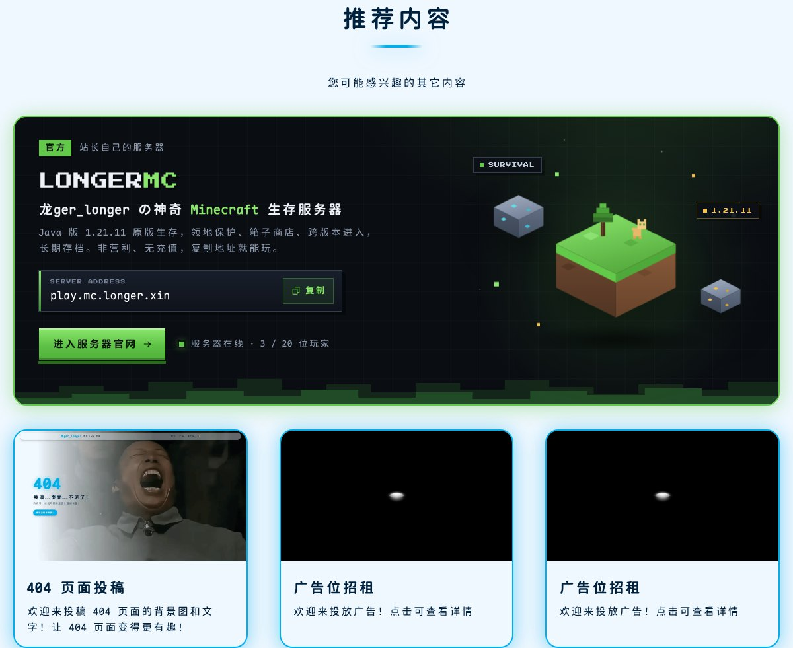
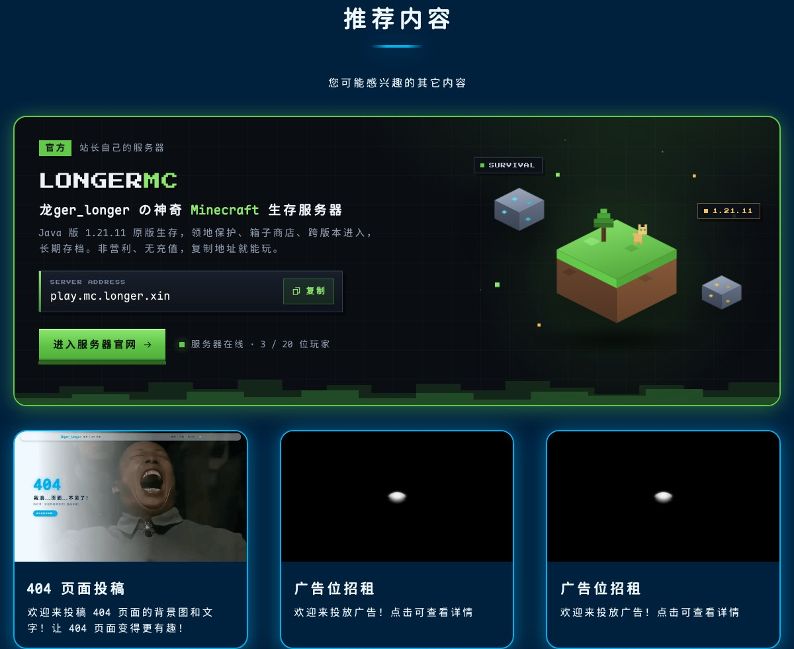
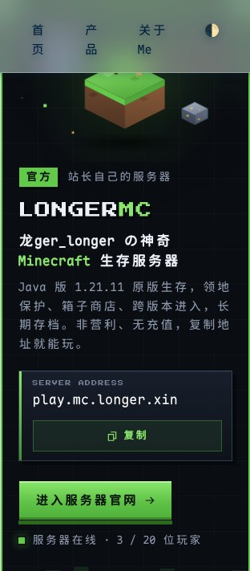
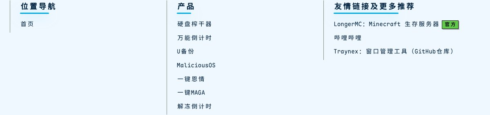
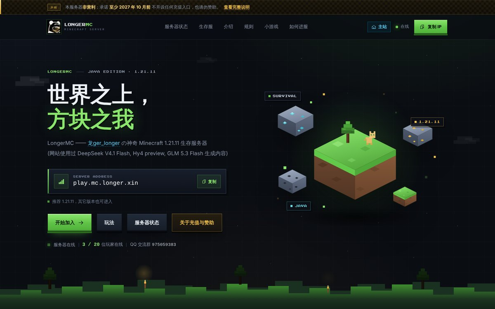
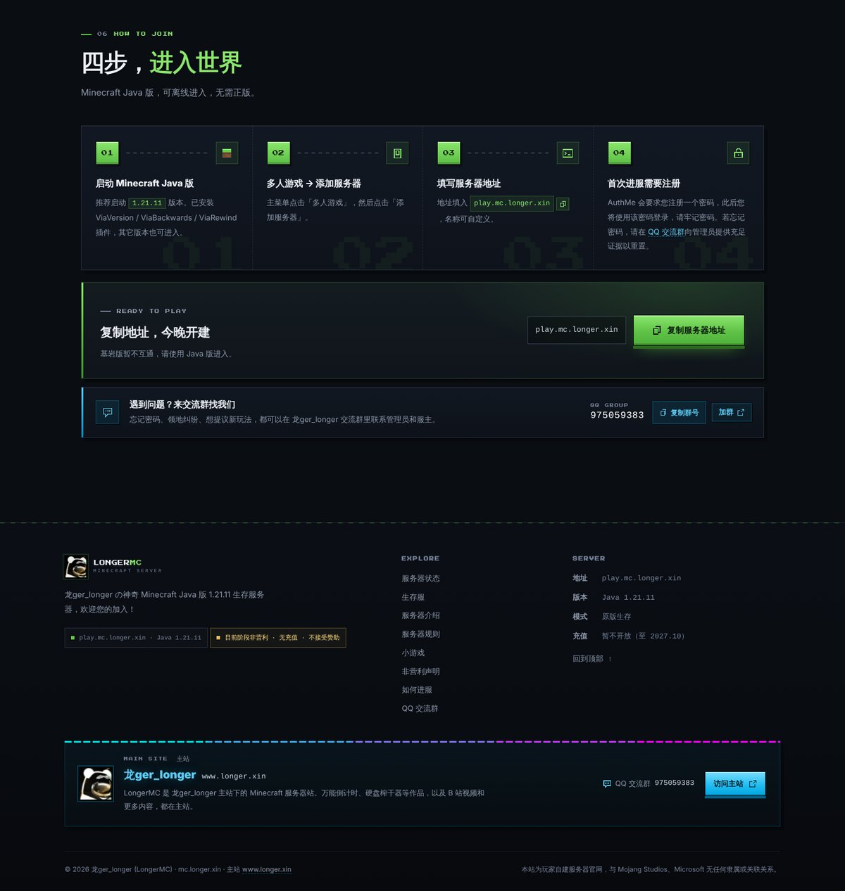
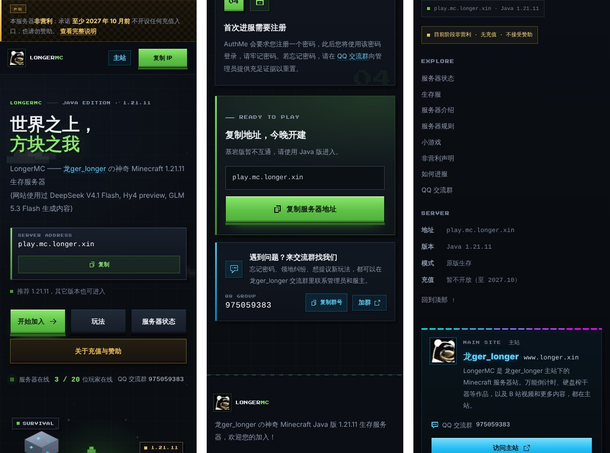

# LongerMC × 龙ger_longer 主站：把两个站连起来

给 龙ger_longer 的改动：

- **www.longer.xin**（`0xlonger.github.io`）的推荐内容里加一张 LongerMC 官方推荐卡片；
- **mc.longer.xin**（`longer-mc-web`）上写明主站是 www，同时写明 QQ 群。

改动基于 GitHub 上的最新提交：`longer-mc-web@0c08633`、`0xlonger.github.io@0ca2f32`。
群里 23:13 截图里的版本（www 已经加了 MC 广告和页脚链接）还没推到 GitHub，所以这里没有在它的基础上改。如果本地已经有自己做的版本，二选一就行，不要叠在一起。

## 思路：每个站有自己的“身份色”

| | 主站 www | MC 站 mc |
| --- | --- | --- |
| 颜色 | B 站蓝 `#00aeec`，横幅的青→紫渐变 | 草方块绿 `#63c94a` |
| 形状 | 圆角、柔和发光、悬停放大 | 直角、硬投影、像素字 |

规则只有一条：**只有指向对方的东西才用对方的颜色。**

- MC 站上的蓝色只出现在指向主站或 QQ 群的元素上，MC 站自己的按钮、标题全部不动，所以不会再“按钮和页面主题不搭”。
- 主站上的绿色只出现在 LongerMC 卡片和页脚的“官方”小标签上。

不只是换个圆角、换个颜色，而是“外框跟随所在的站，内容带着自己的风格”：

- **www 上的 MC 卡片**：外框用主站的写法（20px 圆角、2px 描边、发光阴影、悬停放大，跟旁边的推荐卡片一样），里面是 MC 站的世界（夜空网格、漂浮的草方块和矿石、像素字、硬边绿色按钮、和 MC 站一样的地址卡片），像在主站上开了一扇通往 MC 世界的窗。
- **MC 站上的主站元素**：形状仍然是 MC 的（直角、硬投影、像素字），只是换成主站的蓝色。页脚主站卡片顶上的虚线，是主站横幅的青→紫渐变“像素化”后的样子；鼠标放上去头像会转一圈（主站头像的招牌动作），只是换成了方形头像。

## 预览

**www：推荐内容（亮色 / 暗色主题）**




**www：手机端卡片、页脚友情链接**

 

**mc：首屏（导航“主站”入口、简介里的站长链接、状态行里的 QQ 群）**



**mc：加入区交流群条、页脚主站卡片**



**mc：手机端**



## 改了什么

### www.longer.xin（0xlonger.github.io）

| 文件 | 改动 |
| --- | --- |
| `partials/ad.html` | 推荐内容最上方加 LongerMC 官方卡片，原来三张推荐卡片不动 |
| `css/style.css` | 新增「官方推荐：LongerMC 服务器卡片」一节（全部是 `.lmc-*`，不影响其他样式）+ 像素字体声明 |
| `js/ad.js` | 加载推荐内容后初始化卡片：复制服务器地址、在线人数 |
| `partials/footer.html` | 友情链接第一条加 LongerMC（带“官方”标签） |
| `fonts/Press Start 2P/` | 像素字体（12 KB，SIL OFL 许可，和 MC 站用的是同一个文件） |

- **和其他推荐区分开**：左上角有“官方”标签，写着“站长自己的服务器”；卡片单独一整行，放在第三方推荐上面，配色也和它们完全不同。
- **显眼**：亮色主题下是深色卡片配绿色发光，对比很强；暗色主题下也一样醒目。
- **不破坏体验**：不弹窗、不自动播放、不挡内容。唯一的动画是方块慢慢上下浮动，系统开了“减少动态效果”就不动。在线人数只在卡片快滚到眼前时请求一次，请求失败就不显示，不会误显示成“维护中”。
- 可以一键复制服务器地址，也能直接点进 mc.longer.xin。
- 卡片图标直接用主站已有的 `avatars/龙ger_longer.webp`（和 MC 站的 `icon.jpg` 是同一张图），没有新增图片。
- 类名用的是 `lmc-*`，不带 ad，被广告拦截插件误杀的可能小一些。不过整个 `#ad` 区块本来就可能被拦，所以页脚又放了一条链接兜底。

### mc.longer.xin（longer-mc-web）

**写明主站是 www**

- 导航右侧加“主站”入口，手机上也显示；
- 首页简介里的“龙ger_longer”链接到主站；
- 页脚加主站卡片：头像、龙ger_longer、`www.longer.xin`，以及“访问主站”按钮（全站唯一一个蓝色按钮）；
- 页脚最底下一行加“主站 www.longer.xin”；404 页面的导航和页脚也同步加上了；
- 首页的结构化数据（JSON-LD）里写上作者是 龙ger_longer（www.longer.xin），让搜索引擎知道两个站是一家的。

**QQ 群：不过于显眼，也不容易被忽略**

- 首屏在线状态那一行末尾加一行小字“QQ 交流群 975059383”，点击会跳到交流群条；
- 加入区（“四步，进入世界”下面）加交流群条，可以复制群号或加群，颜色比上面的绿色“复制服务器地址”低调；
- 用户真正需要找管理员的地方直接链到交流群：“账号保护”卡片、第 4 步的“忘记密码”、小游戏的“提建议”；
- 页脚主站卡片和 EXPLORE 栏里也有。

`README.md` 的功能列表也同步更新了。

## 怎么用

三种方式任选一种。

**1. 直接替换文件**：`files/` 下按仓库放好了改动后的完整文件，复制到对应仓库覆盖就行。www 那边记得把 `fonts/Press Start 2P/` 整个文件夹一起复制过去。

**2. 用补丁（保留提交说明）**

```bash
cd longer-mc-web
git am /路径/longer-web/patches/longer-mc-web.patch

cd 0xlonger.github.io
git am /路径/longer-web/patches/0xlonger.github.io.patch
```

只想改文件、不想自动提交的话，把 `git am` 换成 `git apply`。

**3. 先本地看效果**：在任一仓库目录运行 `python3 -m http.server 8080`，然后打开 `http://localhost:8080`。

## 测过什么

- 用 Chromium 在 1440 / 1024 / 768 / 390 / 320 像素宽度下截图检查，www 的亮色、暗色主题都看过；
- 新加的元素在任何宽度下都不会产生横向滚动；
- 复制按钮实际写入了剪贴板；在线人数的三种情况（在线 / 维护中 / 接口失败）都试过，显示正确；
- 两个补丁在干净的仓库上用 `git am` 和 `git apply` 都能直接打上，打完的文件和这里的 `files/` 完全一致。
- 顺带发现一个原有问题（没改）：主站“产品展示”在 320px 宽的手机上会超出屏幕 4px，原因是 `.projects-grid` 的最小列宽是 288px。
